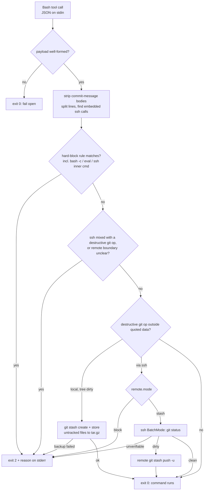

# claude-code-guardrails

A `PreToolUse` hook for Claude Code that backs up your dirty git tree before an agent runs `git reset --hard`, and refuses outright the commands nothing can undo.

## Why it exists

A coding agent was debugging a broken checkout. To get a clean baseline it ran `git checkout -f`. The working tree held uncommitted work, and git did exactly what it was told: the changes were gone, with no stash and nothing in the reflog to recover them from. The agent wasn't malicious or confused. In diagnosis mode, "force the tree back to a known state" is a reasonable move, and the agent had no sense that the dirty files mattered.

Telling the agent "be careful" doesn't fix this. A rule in a prompt is a request, and requests get dropped once the context is long and the agent is focused on a bug. The fix has to be mechanical: something outside the model that sees every shell command before it runs.

The hook sorts commands into two classes:

| Class | Examples | What the hook does |
|---|---|---|
| **Recoverable, if a backup exists** | `git reset --hard`, `git checkout -f`, `git checkout -- <path>`, `git clean -f`, `git switch --discard-changes`, `git restore --source` | If the target tree is dirty, back it up **without touching it**, then let the command run |
| **Unrecoverable** | push (forced or plain) to a protected branch, `git commit` on a protected branch, recursive `rm`/`find -delete` on `/`, system dirs, your home, protected repos or irreplaceable paths (or their contents, `~/*`), `mkfs`, `dd of=/dev/…`, shutdown/reboot, sshd_config writes, `sudo -S`/`-A` | Block (exit 2). The command never runs, and the agent sees the reason |

## How it works



Design points that matter more than the regexes:

- **The backup never modifies the tree.** Tracked changes are recorded with `git stash create` plus `git stash store`, so the working tree and index stay as they were and the entry shows up in `git stash list`. Untracked files go to a mode-0600 tar.gz written atomically under a mode-0700 directory. An earlier design used `git stash push -u`. When a command only *mentioned* `git reset --hard` inside a string, that design swept live, uncommitted files out of a checkout that other processes were reading. This version can only add backups.
- **Quoted data is not an operation.** `echo 'git reset --hard'`, a `-m` commit message or a quoted heredoc never triggers a backup. Anything that could execute the quoted text (`bash -c`, `| sh`, `python -c`, `$(…)`, backticks, an unquoted heredoc that expands) is still treated as a real command.
- **Fail closed where it counts, fail open where it doesn't.** A malformed hook payload exits 0, because a crashing hook would block every tool call. An internal error, an unparseable config file, a backup that can't be written, an untracked set over the size cap, a remote tree that can't be inspected, or a command too large to scan in its time budget all exit 2.
- **Parsing never widens side effects.** Static parsing of ssh lines can only add *block* checks. The only reading of a line allowed to make the hook run `ssh` or create a backup is the narrowest one. If the boundary of a quoted remote command is ambiguous (glued quotes, an unbalanced quote, a local destructive op chained after `ssh`), the hook blocks instead of guessing.
- **Command position, not substring.** `cat /var/run/reboot-required`, `grep reboot`, `man mkfs` and `git push origin feature/main-menu` are allowed. `rm -fr`, `rm -r -f`, `rm --recursive`, `/bin/rm -rf ~`, `rm -rf "${HOME}"`, `rm -rf ~/*` and `git -C repo push origin +main` are all recognised.
- **The repo is the one git will actually touch.** The target of a backup or a branch check is the hook's cwd, moved by any `cd <path>` earlier in the command and by `git -C <path>` (so `git -C ../other reset --hard` backs up `../other`, and each repo in a chained command gets its own backup). If that path can't be known statically (`cd "$REPO"`, a quoted path with spaces, `--git-dir`/`--work-tree` on a destructive op), the hook blocks instead of backing up the wrong tree.
- **Pushes are judged by where they land.** A push that names a protected branch is blocked statically. A push whose destination git chooses (`git push`, `git push origin`, `git push origin HEAD`, `--all`) is resolved against the local repo before it runs: if the current branch, its upstream or its push target is protected (or, for `--all`, a protected branch exists locally), it is blocked. `--mirror` is blocked whenever any branch is protected.
- **Bounded cost.** At most 32 ssh occurrences per command, a 256 KB scan-work budget and a 3 s deadline on the extra scans. Past any of these the hook blocks with "split it" and stops scanning.

## Install

Requires Python 3.9+ and git. No third-party packages.

```bash
pip install git+https://github.com/nmcbride-42/claude-code-guardrails
```

Then add the hook to `~/.claude/settings.json` (all projects) or `.claude/settings.json` (one project):

```json
{
  "hooks": {
    "PreToolUse": [
      {
        "matcher": "Bash",
        "hooks": [
          { "type": "command", "command": "claude-code-guardrail", "timeout": 10 }
        ]
      }
    ]
  }
}
```

If you'd rather not install a package, copy `claude_code_guardrails/guardrail.py` anywhere and use `"command": "python3 /absolute/path/to/guardrail.py"`. It is a single standard-library file.

Try it without Claude Code:

```bash
echo '{"tool_input":{"command":"git push --force origin main"},"cwd":"."}' | claude-code-guardrail; echo "exit=$?"
# SAFETY GUARDRAIL: Blocked: force-push to protected branch 'main'. Unrecoverable op. ...
# exit=2
```

## Configuration

Configuration is optional, and the defaults are reasonable. The hook reads `$CLAUDE_GUARDRAIL_CONFIG` if set, otherwise `~/.config/claude-code-guardrails/config.json`. Your file is merged over the defaults. An invalid file blocks every command until you fix it, so a typo can't quietly turn your protections off. See [`examples/config.json`](examples/config.json):

```json
{
  "protected_branches": ["main", "master"],
  "block_commit_on_protected_branch": true,
  "protected_repos": [
    { "name": "my-app", "paths": ["~/code/my-app", "/srv/my-app"] }
  ],
  "protected_paths": [],
  "irreplaceable_paths": ["~/.claude", "~/.ssh", "~/.gnupg", "~/code/my-app/data"],
  "remote": { "mode": "stash", "allowed_hosts": ["build-box"] },
  "backup_untracked_cap_mb": 32
}
```

| Key | Meaning |
|---|---|
| `protected_branches` | A push that names one of these as its destination is blocked, forced or not, and so is a local push whose implicit destination (current branch, upstream, push target, `--all`) is one of them. So is `git commit` while one is checked out. See Limits for the pushes this can't resolve. |
| `block_commit_on_protected_branch` | Turn the commit check off. The branch is read *before* the command runs, so `git switch -c x && git commit` in one call is still blocked. Run the switch on its own. |
| `protected_repos` | Named repos whose checkout paths cannot be recursively deleted *as themselves*. Their subpaths (`build/`, `node_modules/`) stay deletable. |
| `protected_paths` | Extra directories with the same "exact root" protection. `/`, `/home`, `/Users` and your home directory are always protected. |
| `irreplaceable_paths` | Data git can't bring back. Deleting the path **or any ancestor** of it is blocked. |
| `remote.mode` | Default `block`. `stash`: for a destructive git op sent as `ssh host 'cd <repo> && …'`, check the remote tree over ssh (BatchMode) and `git stash push -u` it there if it's dirty. If the remote can't be inspected, block. `block`: block every destructive git op sent over ssh, and never open an ssh connection from the hook. Opt into `stash` only for remotes you trust the hook to run `git stash push -u` on (the example config does this for one named host). |
| `remote.allowed_hosts` | In `stash` mode, hosts not listed (when the list is non-empty) are treated as `block`. |
| `backup_untracked_cap_mb` | When untracked files total more than this, the hook blocks instead of archiving them. |

Environment variables (also listed in [`.env.example`](.env.example)):

| Variable | Default | Purpose |
|---|---|---|
| `CLAUDE_GUARDRAIL_CONFIG` | `~/.config/claude-code-guardrails/config.json` | Config file path. If set, the file must exist. |
| `CLAUDE_GUARDRAIL_LOG` | `~/.cache/claude-code-guardrails/events.jsonl` | Event log (one JSON line per block or backup). Set to `none` to disable. |
| `CLAUDE_GUARDRAIL_BACKUP_DIR` | `~/.cache/claude-code-guardrails/backups` | Where untracked-file archives go. |

**Recovering:** every backup prints its location to stderr and is logged. Tracked changes come back with `git stash list` and `git stash apply stash@{N}`. Untracked files come back with `tar -xzf <archive> -C <repo>`.

## Limits

- **Headless runs are covered only if they load the hook.** On Claude Code 2.1.327, PreToolUse hooks do fire in print mode (`claude -p`), but only hooks in the settings that run actually loads. A headless agent launched with isolated settings (for example `--setting-sources ""`) gets no protection unless you pass the hook in with `--settings`. Older versions behaved differently in our use, so test it on yours: a hook that appends to a file, plus `claude -p "run: echo test"`, shows it in seconds.
- **Bash tool only.** The hook sees what the Bash tool runs. It doesn't see file edits made through the Edit or Write tools, or anything a script does once it's running. A destructive op inside a script file (`./cleanup.sh`) is invisible to it.
- **Denylist, not a sandbox.** The hook catches the destructive shapes it knows. A determined or adversarial process can get around a regex-and-tokenizer guard (for example by building a command from variables at runtime). Treat it as a seatbelt against honest mistakes, not as a security boundary.
- **The remote stash is a real `git stash push -u`.** Unlike the local backup, it clears the remote tree before the destructive op runs. The op would have discarded those changes anyway, but it is a side effect on another machine. Set `remote.mode` to `block` if you don't want that.
- **Some push destinations aren't resolved.** Implicit destinations are read from the local repo only. A bare `git push` sent over ssh, refspecs configured in `remote.<name>.push`, and destinations held in shell variables are not resolved; only explicitly named protected branches (and `--mirror`) are blocked in those cases. Server-side branch protection is the real backstop for a protected branch.
- **An agent can edit the config.** If that worries you, deny writes to the config path in your Claude Code permission settings.

## Tests

```bash
pip install pytest
python -m pytest -q
```

The suite runs offline in under a minute and needs no network. It invokes the hook exactly as Claude Code does: a subprocess with JSON on stdin. It runs against disposable git repos and puts a fake `ssh` on `PATH`, so no real host is contacted. The tests pin these behaviours:

- the bypasses found in review (flag-order and absolute-path `rm` variants, `~/*` globs, `+refspec` force pushes, `git -C` before `push`/`commit`/`reset`, implicit-destination pushes, ssh chains that hid a remote op, glued quoting)
- the property that backups never change a file's contents, mtime or the index
- recovery of tracked and untracked changes after the real destructive op runs
- fail-closed behaviour (unreadable files, size cap, unreachable remote, bad config)
- time and memory bounds on large or adversarial commands

## Status

A working tool. It has guarded the author's interactive Claude Code sessions as part of a larger agent harness, and this repo is a standalone extraction of that hook with the environment-specific parts made configurable. It is Linux/macOS only (POSIX shell semantics and paths). Expect false positives at the edges. When it blocks something legitimate, the stderr message says why, and the fix is usually to split the command.

## How it was built

Designed by Nick McBride and built with his AI agent Iris (Claude-based) as part of a personal research platform.

## License

MIT. See [LICENSE](LICENSE).
